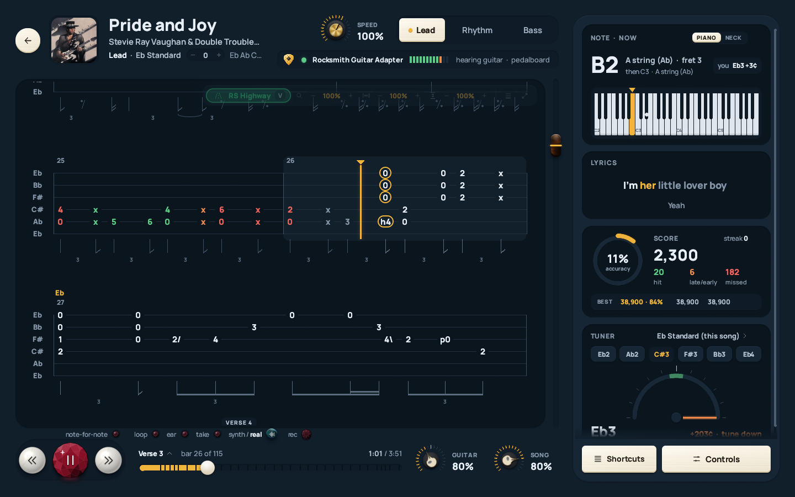
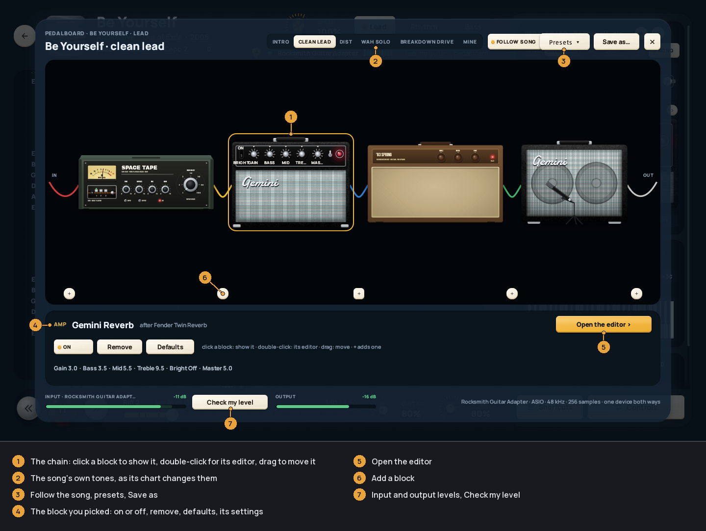
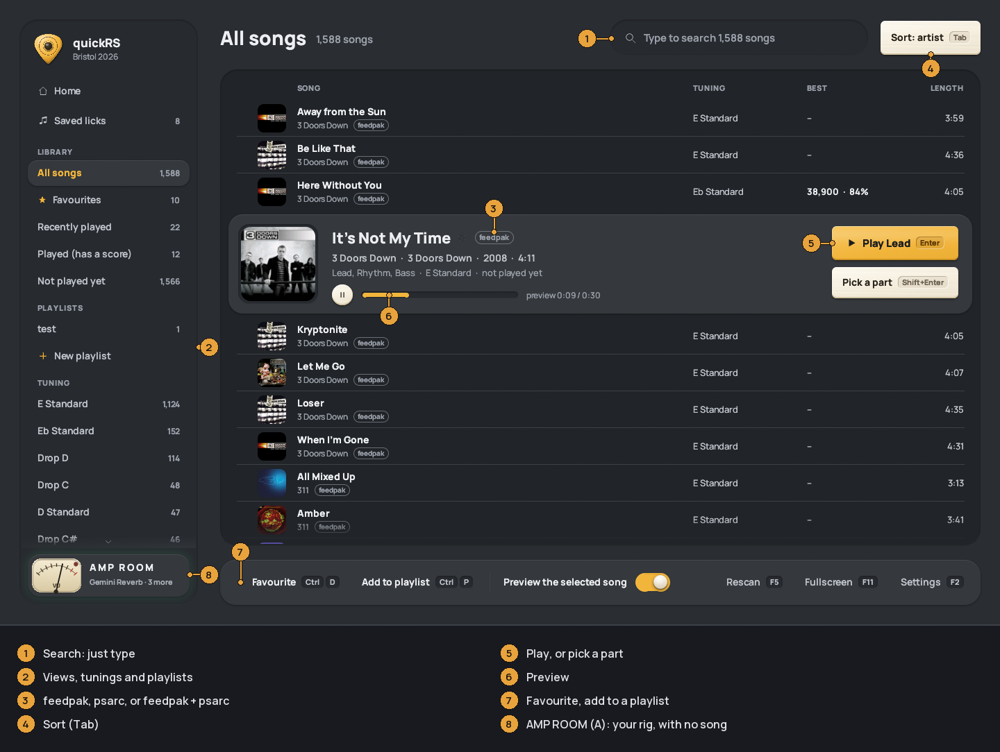
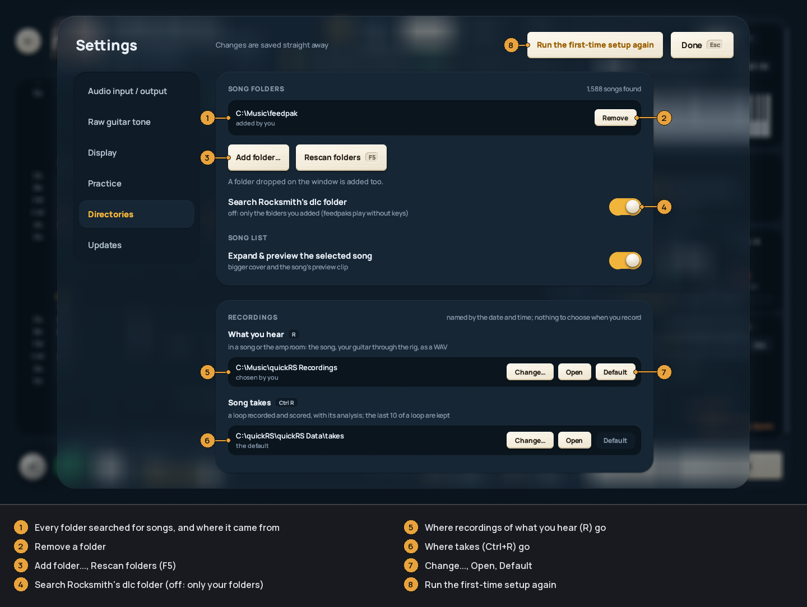

quickRS
-------

[**⬇ Download for Windows**](https://github.com/arpan2711/quickRS-player/releases/latest) · [**⬇ Download for Mac** (beta)](https://github.com/arpan2711/quickRS-player/releases/latest) · [Get your songs in](docs/GETTING-SONGS.md) · [Report a bug](https://github.com/arpan2711/quickRS-player/issues) · [**☕ Support it**](https://ko-fi.com/arpanmitra)

quickRS is a practice player for the Rocksmith 2014 songs you already own. It
reads your `.psarc` files (or feedpaks, an open one-file-per-song format),
shows the chart as scrolling tab or as a 3D note highway, and listens to your
guitar through a Real Tone Cable, an audio interface or a microphone. You can
loop a passage, slow it down without changing the pitch, shift the pitch,
make the song wait for each note, record a take and see what you got wrong,
play through a pedalboard or an amp room, and record what you hear.
It doesn't change your Rocksmith install.

quickRS is free and MIT licensed. It is a hobby project made by one person
with a lot of help from an AI coding assistant, and it has had few testers
beyond me and the people who tried 0.1.0. Bug reports are very welcome:
Settings > *Updates* > *Report a bug* in the app, or
[GitHub Issues](https://github.com/arpan2711/quickRS-player/issues).




### Takes: feedback on your playing, straight away

Loop a stretch, press `Ctrl+R`, play it once, and a second later quickRS shows
how it went: each note and chord right, wrong (and what you played instead),
missed or extra, your timing (rushing or dragging, and by how many
milliseconds), bar by bar, the problems in plain words, and your own tab drawn
over the song's. `B` plays the take back over the song.

It's signal processing checked against the chart, done on your computer: no
AI model, no upload, and the same take always gets the same answer. See
[Takes](docs/PLAYING.md#takes).


### Download

* **Windows 10 or 11 (64-bit):** `quickRS-0.3.0-windows-x64.zip` from the
  [latest release](https://github.com/arpan2711/quickRS-player/releases/latest).
  There is no installer: unzip it and run `quickrs.exe`.
* **macOS 11 or later (beta):** `quickRS-0.3.0-macos-universal.dmg` (or the
  `.zip`) from the same page. One app for Apple silicon and Intel Macs. It is
  tested on one Mac so far and not notarised by Apple, so the first start
  takes an extra step. See [docs/INSTALL.md](docs/INSTALL.md#macos).
  On a Mac, the keys written Ctrl in these docs are Cmd (a take is `Cmd+R`).

No songs and no Rocksmith keys are included.

Have 0.1.0? It can't update itself, so download the 0.3.0 zip by hand this
once and unzip it over your old folder or beside it; your settings and scores
carry over. From 0.3.0 on, quickRS updates itself. See
[UPDATING](docs/UPDATING.md#from-010).


### Documentation

* [Installing](docs/INSTALL.md), including the Windows SmartScreen and macOS
  Gatekeeper warnings, and where your data is kept.
* [Getting your songs in](docs/GETTING-SONGS.md): song folders, feedpaks,
  psarcs and the keys, the converter.
* [Audio setup](docs/AUDIO-SETUP.md): the guided guitar setup, Real Tone
  Cable, interfaces, ASIO and WASAPI, calibrating your input, the pedalboard
  and the amp room.
* [Playing](docs/PLAYING.md): tab, highway, loops, slow-down, note by note, ear
  mode, takes, recording, scoring, pitch and stems.
* [Updating](docs/UPDATING.md), including coming from 0.1.0.
* [Troubleshooting](docs/TROUBLESHOOTING.md), and how to report a bug.


### Hidden gems

Easy to miss, and some of the best parts. `F1` in a song lists every key.

* **Ctrl+drag over the tab** (or Ctrl+click a bar) to select a passage. A
  small bar appears under it: **Play** it on the synth guitar or from the
  song itself (the shell key switches), **Loop** it, **Slow** it down, or
  **Save lick** to keep it on the Saved licks page.
* **Take review** (`Ctrl+R`): loop a few bars, play them once, and a second
  later you see what was right, wrong (and what you played instead), missed
  or rushed, bar by bar, with your own tab drawn over the song's. `B` plays
  your take back over the song. All on your computer, no AI.
* **The RS Highway** (`V`, or the green *RS Highway* key on the tab's
  toolbar): the 3D Rocksmith-style note highway with a camera that follows
  the frets. `I` turns it upside down.
* **Note by note** (`W`): the song stops at each note and waits until you
  play it.
* **Ear mode** (`H`): the notes are hidden until you've played them, for
  learning by ear.
* **Synth or real guitar** (`G`): hear exactly what the tab says, played by
  the synth in place of the recording's guitar.
* **The amp room** (`A` on Home, or the AMP ROOM meter at the foot of the
  sidebar): play through a rig with no song, save sounds, switch them with
  `1`-`4`. In a song, `Shift+T` loads those sounds on the Pedalboard tile.
* **Every song's own tone**: the Pedalboard tile builds the song's
  Rocksmith tone as amps and pedals for you to play through and tweak.
* **The lamps above the play key are buttons**: click *loop*, *ear*, *take*,
  *synth / real* or *rec* instead of remembering the keys.
* **The guitar pick at the top of the sidebar** switches the look:
  Midnight, Graphite, Daylight.
* **Drop a folder on the window** to add it to your library.
* **Sounds late?** `,` and `.` nudge the sync, `Ctrl+,` and `Ctrl+.` your
  guitar's timing.


### What's new since 0.1.0

0.1.0 (14 October 2026) was the first release; 0.3.0 is the next one. In
short:

Setting up

* A first-time setup opens over the app on a new install: *Look*, *Your
  guitar*, *Low latency*, *Note widget*, *Keys and folders*, *Done*. *Run the
  first-time setup again* at the top of Settings (`F2`) opens it any time.
* *Your guitar* is a guided setup: the input and its channel, the output, a
  level check that says what to turn, what's plugged in (guitar, amp
  modeller or microphone), calibration the Rocksmith way (knobs up, hands
  off, then strum as hard as you can), and a check of the open strings.
* Keys pasted in Settings > *Directories*, `keys.json.txt` read too, and songs
  read as soon as the keys arrive: no restart, no `F5`.
* Song folders listed with *Add folder...* and *Remove*; a switch to read
  only your feedpaks; each song marked `feedpak`, `psarc` or both.
* quickRS updates itself (it asks first), and Settings > *Updates* > *Report
  a bug* opens a GitHub issue with your version and system filled in.
* Settings sections renamed: *Audio input / output*, *Raw guitar tone*,
  *Directories*.
* A Mac version (beta).

Practising

* Note by note (`W`): the song waits at each note until you play it.
* Ear mode (`H`): the notes stay hidden until you play them.
* Takes (`Ctrl+R`): the loop recorded and checked bar by bar (above).
* Recording what you hear (`R`): the song and your guitar, to a WAV named
  after the song, in your recordings folder as soon as you stop.
* Synth or real guitar (`G`): the synth plays the part in place of the
  song's guitar.
* Chords score like Rocksmith's (half the notes are enough), and strums are
  found through distorted or clipping inputs.
* Pitch shift (`Shift+↑` / `Shift+↓`, or *TRANSPOSE* in the header), every
  stem of a stemmed feedpak with its own level, saved licks (`Ctrl+S`).
* Every key on one sheet (`F1` or `?`), and what's switched on shown in red
  or amber.

Sound

* The pedalboard: 54 models drawn after the units they model, a detailed
  editor, and Rocksmith songs' own rigs.
* The amp room: play through your rig with no song.

Views

* The 3D note highway (`V`).
* Tab shape: bar width, string spacing, compact rows, full-screen tab.
* Tiles fold; a new look in three themes.

The full list is in the
[0.3.0 release notes](https://github.com/arpan2711/quickRS-player/releases/tag/v0.3.0).


### Features

The numbers on each picture are explained under it.

#### Tab

The whole part as pages of tab with rhythm notation, the current bar lit and
the next notes ringed. Lead, Rhythm and Bass are a key apart.


#### Loops and slowing down

`[` and `]` set a loop on the beat, `L` loops the section, and the speed goes
from 25% to 150% without changing the pitch. The *Controls* key opens all of
it.


#### Highway

A Rocksmith-style 3D note highway, in place of the tab (`V`).


#### Note by note

The song waits at each note until you play it.


#### Takes and recording

`Ctrl+R` records the loop and checks it against the chart, bar by bar (the
picture at the top). `R` records what you hear, song and guitar, to a WAV
file named after the song; it appears in your recordings folder when you
stop.

#### Pitch and stems

The song up or down in semitones, and, for a feedpak split into stems, each
stem's level. This picture is from a small example pack with guitar, drums,
vocals and click stems.


#### Pedalboard

Pedals, amp, cab and effects for a dry guitar input, each drawn after the
kind of unit it models.



#### Amp room

Your rig on a stage, with no song: scenes, saved sounds, and every song's own
tone to try.

#### Library



#### Setting up

A first-time setup on the first start (the look, your guitar, low latency,
the note widget, keys and folders), and the song folders and keys in
Settings > Directories.




#### Also

Scoring with your best three runs per part, a tuner set to the song's tuning,
lyrics, a difficulty slider with level-up after a clean loop, three themes
(Midnight, Graphite, Daylight), guitar tones (As is, Clean, Crunch, Lead,
Bass, Acoustic, Pedalboard, and your own), and a converter from psarc to
feedpak.


### Quick start

1. Download and unzip quickRS. ([INSTALL](docs/INSTALL.md))
2. Plug in your guitar. A Real Tone Cable is picked by itself.
   ([AUDIO-SETUP](docs/AUDIO-SETUP.md))
3. Start `quickrs.exe`. It finds Rocksmith's `dlc` folder in your Steam
   libraries, and the first-time setup opens: pick a look, set up your guitar
   (a couple of minutes), and add keys and folders. Every page can be
   skipped. ([INSTALL](docs/INSTALL.md#the-first-start))
4. If songs say *needs keys*, paste Rocksmith's two keys into the setup's
   *Keys and folders* page, or Settings (`F2`) > *Directories*, and press
   *Save keys*. Feedpaks need no keys.
   ([GETTING-SONGS](docs/GETTING-SONGS.md))
5. Pick a song, press `Space`, and play. ([PLAYING](docs/PLAYING.md))


### Keyboard shortcuts

Every button shows its key on it, and `F1` (or `?`) in the player shows them
all on one sheet. On a Mac, Ctrl in these keys is Cmd. The full list:

In the player:

| Key | What it does |
| --- | --- |
| `Space` | Play / pause |
| `=` / `Ctrl+=` | Faster / slower (25% to 150%, pitch kept) |
| `Shift+↑` / `Shift+↓` | Pitch up / down a semitone (-12 to +12; also *TRANSPOSE* in the header) |
| `←` `→` | Seek: 1 s, growing to 20 s while held (`Shift`: always 1 s) |
| `-` | Back 5 s |
| `Home` | Back to the start |
| `PgUp` / `PgDn` | Previous / next section |
| `[` `]` | Loop start / end (snaps to the beat) |
| `L` | Loop the current section |
| `\` or `Ctrl+[` | Clear the loop |
| `↑` `↓` | Zoom the tab |
| `Alt+←` `Alt+→` | Bars narrower / wider |
| `Alt+↑` `Alt+↓` | Strings further apart / closer (`Alt+0` resets both) |
| `C` | Compact rows |
| `F` | Full-screen tab (`F` or `Esc` leaves) |
| `V` | RS Highway / tab |
| `I` | On the highway: invert the strings |
| `A` / `Shift+A` | Next / previous part |
| `1`-`6` | Part 1 to 6 |
| `Ctrl+↑` / `Ctrl+↓` | Harder / easier |
| `Y` | Lyrics tile on / off |
| `N` | Rhythm notation on / off |
| `H` | Ear mode |
| `W` | Note by note |
| `Enter` | Note by note, while it waits: skip the note |
| `Ctrl+R` | Record a take of the loop and check it (`Ctrl+R` again stops) |
| `B` | Listen back to the last take |
| `R` | Record what you hear; again: pause / resume |
| `Shift+R` | Stop the recording and save it |
| `G` | Synth / real guitar |
| `9` `0` / `7` `8` | Song volume / guitar volume |
| `,` `.` | Audio / notes sync, 10 ms steps |
| `Ctrl+,` `Ctrl+.` | Guitar timing |
| `M` | Hear your guitar on / off |
| `T` | Next guitar tone |
| `Shift+T` | Your saved sounds, on the Pedalboard tile |
| `Ctrl+drag`, `Ctrl+click` | Select bars; then `P` play, `S` slower, `Esc` clear |
| `Ctrl+S` | Save the selection or loop as a lick |
| `F1` or `?` | Every key on one sheet |
| `Esc` / `Backspace` | Back to the library (`Esc` first closes the end-of-song card) |

The stem mixer has no keys; it is in *Controls* > *PITCH & STEMS*.

In the amp room:

| Key | What it does |
| --- | --- |
| `1`-`4` | Scenes |
| `←` `→` | Previous / next saved sound |
| `G` / `L` | The Rig / Sounds tab |
| `Ctrl+F` | Search the sounds |
| `` ` `` | A/B against the saved sound |
| `Tab`, `Space`, `E` | Next block, switch it on / off, open its editor |
| `Ctrl+Z` / `Ctrl+Y` | Undo / redo |
| `Ctrl+S` / `Ctrl+Shift+S` | Save / Save as |
| `R` / `Shift+R` | Record what you hear (again: pause / resume) / stop and save |
| `Esc` | Back |

In the library:

| Key | What it does |
| --- | --- |
| typing | Search |
| `Enter` / `Shift+Enter` | Play / pick the part |
| `Ctrl+D` | Favourite |
| `Ctrl+P` | Add to a playlist |
| `Del` | Remove from this playlist |
| `Tab` | Sort |
| `F5` | Read the song folders again |

Anywhere: `F2` settings, `F11` full screen. On Home, `A` opens the amp room.

You can also drop a `.psarc` or `.feedpak` file, or a folder, on the window.


### Building from source

The source in this repository is the same code as the release, minus the parts
for one particular USB pedal that only I use.

On Windows you need Rust (stable, MSVC toolchain) with the Visual Studio Build
Tools ("Desktop development with C++"), and LLVM for ASIO support and the
time-stretcher: set `LIBCLANG_PATH` to LLVM's `bin` folder. The build
downloads the ASIO SDK.

```
cargo build --release -p qrs-app -p qrs-cli -p qrs-convert
cargo test --workspace
```

The programs are in `target/release`: `quickrs.exe` (the player),
`quickrs-cli.exe` (song info, tabs, conversion, devices, take checks) and
`quickrs-convert.exe` (the converter window, shipped as
`quickRS Converter.exe`).

On macOS you need Rust (rustup) and Xcode or its Command Line Tools.
`bash tools/mac/bundle.sh` builds the universal `quickRS.app` and its zip and
`.dmg` into `dist/mac/`; step by step in [docs/BUILDING-macOS.md](docs/BUILDING-macOS.md).
`.github/workflows/release-mac.yml` builds the same on GitHub's Macs.


### Legal

quickRS is not made by or affiliated with Ubisoft. Rocksmith is a trademark of
Ubisoft Entertainment. quickRS includes no songs and no decryption keys. It
plays songs you own and custom songs (CDLC); please don't share what you
extract. quickRS is MIT licensed; the Manrope font is SIL OFL and ww2ogg's
codebooks are BSD.


### Reporting a bug

In quickRS: Settings (`F2`) > *Updates* > *Report a bug*. It opens a new
issue on [GitHub Issues](https://github.com/arpan2711/quickRS-player/issues)
in your browser with your quickRS version and system filled in; say what
happened and what you did just before. *Show the log file* finds the log to
attach if quickRS crashed or showed an error. You need a GitHub account.
See [TROUBLESHOOTING](docs/TROUBLESHOOTING.md#reporting-a-bug).


### Support

quickRS is free. If it helps your practice, you can buy me a coffee at
[ko-fi.com/arpanmitra](https://ko-fi.com/arpanmitra).
