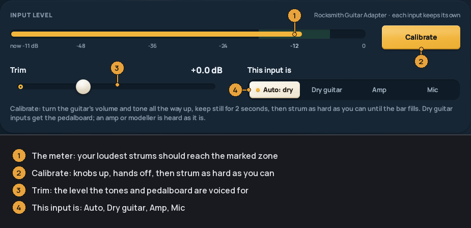

Audio setup
-----------
quickRS listens to your guitar to score your notes, drive note by note and
ear mode, and record takes. It needs a guitar input and an output. Both are
picked automatically; Settings (`F2`) > *Audio input / output* shows what was
picked and lets you choose something else.

* [The guided setup](#the-guided-setup)
* [Inputs](#inputs)
* [ASIO and WASAPI](#asio-and-wasapi)
* [Calibrating your input](#calibrating-your-input)
* [Hearing your guitar](#hearing-your-guitar)
* [The pedalboard](#the-pedalboard)
* [The amp room](#the-amp-room)
* [Timing](#timing)

### The guided setup

*Set up your guitar*, in Settings > *Audio input / output*, walks you
through everything on this page in a couple of minutes. It's also the *Your
guitar* page of the [first-time setup](INSTALL.md#the-first-start). Coming
from 0.1.0, run it once: calibration and the scoring are new since then.

Every step has *Back*, *Skip* and *Next* (or `Backspace`, `S` and `Enter`).
`Esc` leaves.

1. **Pick your guitar's input.** Plug the guitar in first. *Automatic* picks
   the best input it finds; pick yours if it chose wrong. On an interface,
   pick the channel the guitar is on, or leave it on *Automatic* and play a
   few clear notes.
2. **Pick where you hear it**: speakers or headphones.
3. **Is it working?** Play and watch the meter. It says, in words, whether
   nothing is coming in, it's very quiet, it's a good level, a little hot, or
   clipping, and what to turn. If it clips, turn the gain knob on your
   interface down until its light stays off on your hardest strum.
4. **What's plugged in?** *Guitar straight in* (a guitar cable into an
   interface, or a Real Tone Cable: the pedalboard gives it its tone), *Amp
   modeller or processed* (heard as it comes in), or *Microphone*.
   *Automatic* guesses from the device's name.
5. **Calibrate.** See [below](#calibrating-your-input). About 10 seconds.
6. **Your input settings.** What calibration recommends: the trim and the
   pluck sensitivity, as sliders, with meters that move as you play. Leave
   them, or move them and press *Back to recommended* to undo.
7. **Check the notes.** Play the open strings one at a time; each lights up
   when quickRS hears it (in E standard; in another tuning the note you play
   still shows).
8. **All set.** A summary of what was set. If your hits show as late or
   early in a song later, *Practice settings* takes you to
   [Guitar timing](#timing).

Everything is saved for that input. Plug in another and set it up the same
way.

### Inputs

**Real Tone Cable.** Plug it in. quickRS picks it the way Rocksmith does. Its
signal is a dry guitar, so you hear it through quickRS's tones or the
pedalboard.

**An audio interface** (Focusrite, Behringer, and so on). Plug the guitar into
an instrument (Hi-Z or INST) input. quickRS finds which channel the guitar is
on from the first clear notes you play; *INPUT CHANNEL* in Settings > *Audio
input / output* sets it by hand.

**An amp modeller or multi-effects over USB.** It works like an interface.
Set *This input is* to *Amp* so quickRS plays your sound as it is and doesn't
put its own amp on top. The pedalboard tile steps aside for these.

**A microphone**, for an acoustic guitar or an amp in the room. Set *This
input is* to *Mic*: it's heard as it is, and plucks count over the room's
noise. Calibrate it (below); the room's noise matters more than with a cable.

If you already set up Rocksmith with RS_ASIO, *Start on my Rocksmith setup*
picks the same devices.

Plugging in and out while quickRS is open is fine: the song keeps time, and a
new guitar input is offered to you.

On a Mac the first use of an input brings up macOS's microphone question. See
[INSTALL](INSTALL.md#macos).

### ASIO and WASAPI

These are two Windows ways of talking to a sound device. You usually don't
need to choose.

* **WASAPI** works with every device. In shared mode (the default) other
  programs can play sound at the same time. *Low-latency output* (the
  highlighted row) uses exclusive mode: less delay, but other programs go
  quiet while quickRS plays.
* **ASIO** is the interface maker's own driver, and usually the lowest
  latency. quickRS picks it when your interface has one. It is listed in
  Settings > *Audio input / output* as *ASIO driver*.

*Buffer* sets the block size. Smaller is less delay; if you hear crackles,
make it bigger.

On macOS quickRS uses Core Audio, which needs none of this; ASIO and
*Low-latency output* don't apply there.

### Calibrating your input

Each input keeps its own level settings. Calibrate once per input, and again
after you change the interface's gain or the guitar. It works the way
Rocksmith's does: quickRS listens to your loudest playing and sets the level
from it, so nothing clips and soft notes still count.

It's step 5 of the [guided setup](#the-guided-setup), or on its own:
Settings > *Audio input / output* > *INPUT LEVEL* > *Calibrate*.

1. Set your interface's gain so its light never goes red on your hardest
   strum. If it clips, turn the gain down.
2. Turn your guitar's volume and tone knobs all the way up.
3. Press *Calibrate* (or `C`).
4. Take your hands off the strings. It listens to the quiet for 2 seconds.
5. A count of 3, 2, 1, then *Go*: strum as hard as you can on all strings,
   again and again, until the bar fills.

It then recommends:

* **Trim**: the level the pedalboard and tones are voiced for.
* **Pluck sensitivity**: how loud a pluck has to be to count. It's set under
  your soft playing and above your room's noise and hum, so plucks count and
  hum doesn't.

Both are shown as sliders, with meters, so you can play and adjust them;
*Back to recommended* puts them back.

If the interface clipped, or the input is very quiet, it says so and asks you
to change the gain on the interface and calibrate again. It can add up to
24 dB, no more.

*This input is* tells quickRS what it's hearing: *Dry guitar* (the pedalboard
and tones apply), *Amp* (heard as it is) or *Mic* (heard as it is, plucks
counted over the room's noise). *Auto* guesses from the device's name.

### Hearing your guitar

`M` turns your guitar on and off in the output. `T` steps through the tones
(As is, Clean, Crunch, Lead, and your own); Settings > *Raw guitar tone* has
them all, plus Bass, Acoustic and the Pedalboard.

`9` `0` set the song's volume, `7` `8` your guitar's.

### The pedalboard

The pedalboard (its tile in the console, and a big view from the tile's expand
key) is a chain of pedals, amp, cab and effects: 54 models in 10 kinds, each
drawn after the kind of unit it models. A Rocksmith song brings its own rig,
with its amps and pedals matched to the models, and changes tone where the
chart does. There are presets, and you can save your own.

Double-click a block for its editor: the unit large with its values, tips and
the sweet spot, starting points, *Save as my default*, A/B and undo. Delays
can follow the song's tempo. Amps have a *Back panel* (sag, bias, power
tubes, rectifier, power master) and drives an *Inside* (clipping diodes).

`Shift+T` lists your sounds saved in the amp room, on the Pedalboard tile;
pick one to play the song through it. *Back* puts the song's tone back.

### The amp room

The *AMP ROOM* button at the foot of the sidebar (or `A` on Home) opens a page
where you play through your rig with no song. The rig is your own board, the
same one the pedalboard calls *MINE* in a song.

* The *Rig* tab (`G`): the rig on a stage, the selected unit's knobs and its
  editor, a gear shelf, the input meter, a noise gate, a tuner, scenes on
  `1`-`4` and the master level.
* The *Sounds* tab (`L`): your saved sounds, starting rigs, and every song's
  own tone, searchable. Each one is heard as you select it; `Esc` puts yours
  back.
* *Save* (`Ctrl+S`) and *Save as* (`Ctrl+Shift+S`): a name, tags, a colour
  and a favourite slot.
* `R` records what you hear, as in a song (see
  [PLAYING](PLAYING.md#recording)).

Leaving the room puts your tone and monitoring back as they were.

### Timing

If the notes on screen don't line up with what you hear, use `,` and `.` to
move them (10 ms steps). If all your hits show as late or early, use `Ctrl+,`
and `Ctrl+.` to shift when your playing counts. Both are in Settings >
*Practice* too.
