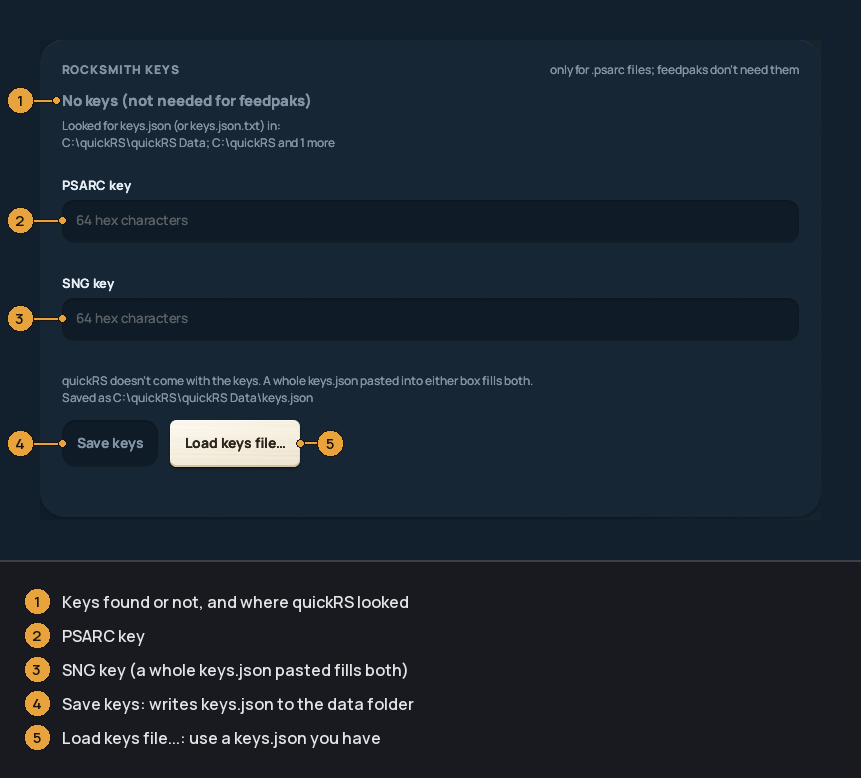

Getting your songs in
---------------------
quickRS plays two kinds of song file:

* **feedpak** (`.feedpak`): an open format, one plain file per song with its
  parts, audio, stems and lyrics. Not encrypted, so it needs no keys.
* **psarc** (`.psarc`): Rocksmith 2014's own format. Encrypted, so quickRS
  needs Rocksmith's two keys to read it. One psarc can hold one song or many
  (the game's `songs.psarc` holds its base songs).

No songs come with quickRS. It plays the ones you own and custom songs (CDLC).

The [first-time setup](INSTALL.md#the-first-start)'s *Keys and folders* page
does the first part of this page (song folders, keys, the recordings folder);
everything here is also in Settings (`F2`) > *Directories*.

* [Song folders](#song-folders)
* [Feedpaks](#feedpaks)
* [Psarcs and the keys](#psarcs-and-the-keys)
* [The converter](#the-converter)


### Song folders

Settings (`F2`) > *Directories* > *SONG FOLDERS* lists every folder quickRS reads
songs from, and where each came from: *added by you*, or Rocksmith's `dlc`
folder (and a `feedpak` folder next to it) found by itself.


* *Add folder...* picks another folder. Dragging a folder onto the quickRS
  window does the same. Subfolders are read too.
* *Remove* stops reading a folder. A folder quickRS found by itself stays
  removed until you add it again.
* *Rescan folders* (or `F5` anywhere in the library) reads the folders again
  and picks up new files.
* *Search Rocksmith's dlc folder* (on by default): quickRS looks for
  Rocksmith's `dlc` folder in every Steam library on the computer. With Steam
  on Windows it is usually:

  ```
  C:\Program Files (x86)\Steam\steamapps\common\Rocksmith2014\dlc
  ```

  and on a Mac:

  ```
  ~/Library/Application Support/Steam/steamapps/common/Rocksmith2014/dlc
  ```

  Turn it off when you have converted your songs to feedpaks and only want
  those: the `dlc` folder and `songs.psarc` are then left alone, while a
  `feedpak` folder next to `dlc` and the folders you added are still read.

Each song in the list is marked `feedpak`, `psarc`, or `feedpak + psarc` when
you have it in both formats; the first one named is the copy that plays. A
song you have in both formats is listed once, and *SONGS IN BOTH FORMATS* in
Settings > Directories picks which copy plays (*The psarc* or *The feedpak*). Your
scores are shared by both copies.


### Feedpaks

If you have feedpaks, put them in a folder and add that folder (see
[Song folders](#song-folders)). That's all. They play without keys.

You can make feedpaks from your own psarcs with [the converter](#the-converter).

A feedpak split into stems (separate guitar, bass, drums, vocals tracks) plays
them all together, and *Controls* > *PITCH & STEMS* sets each one's level. See
[PLAYING](PLAYING.md#pitch-and-stems).


### Psarcs and the keys

Rocksmith encrypts its psarc files. quickRS needs two keys to read them:

* the **PSARC key**, and
* the **SNG key for PC** (for psarcs from a Mac install, the **SNG key for
  Mac**, see [keys.json](#or-make-keysjson)).

Each key is 64 characters long, made of `0`-`9` and `A`-`F`. They are the same
in every copy of Rocksmith. They are not a licence key and have nothing to do
with your Steam account. quickRS can't include them. They are published in
open-source Rocksmith modding tools.

Without keys, psarc songs are listed but marked *needs keys*, with `?` for the
tuning and `0:00` for the length.

#### Paste them in Settings

1. Press `F2` (Settings) and open *Directories*. Scroll down to *ROCKSMITH KEYS*.
2. Paste the PSARC key into *PSARC key*, and the SNG key into *SNG key*. Each
   box checks the key as you type. If you have a whole `keys.json` text,
   paste it into either box and both are filled.
3. Press *Save keys*. quickRS writes `keys.json` to its
   [data folder](INSTALL.md#where-your-data-lives) and reads the songs that
   were waiting for keys straight away. There's no need to restart or press
   `F5`.

*Load keys file...* uses a `keys.json` you already have instead.

The top of the card says what quickRS found: *Keys found: psarc songs play*
(and which file), *No keys yet* (and where it looked), *Only one of the two
keys*, or *Your keys file doesn't read* (and why).



#### Or make keys.json

quickRS also reads a file called `keys.json`. It looks in the data folder
first, then in the quickRS folder (next to `quickrs.exe`). The file looks like
this:

```
{
  "psarc_key": "the PSARC key, 64 characters",
  "sng_key": "the SNG key for PC, 64 characters"
}
```

(For Mac psarcs add a line `"sng_mac_key": "..."`. Remember the comma at the
end of the line before it. *Save keys* in Settings keeps a Mac key that is
already in the data folder's `keys.json`.)

On Windows the easiest way is to start from `keys.example.json`:

1. Right-click `keys.example.json` in the quickRS folder, *Open with* >
   *Notepad*.
2. Replace each `<...>` with its key. Select from `<` to `>`, both included,
   and paste. Leave the quotes.
3. *File* > *Save as*. In *File name*, type `"keys.json"` with the quotes.
4. Save it in the quickRS folder.

If you type `keys.json` without quotes, Notepad saves `keys.json.txt`, and
Windows hides the `.txt`, so the file looks right but isn't. quickRS reads
`keys.json.txt` (and `keys.json.json`) too, so this no longer matters. To see
real file names anyway, in File Explorer choose *View* > *Show* > *File name
extensions*.

A key written as `0x1A, 0x2B, ...` works too.

quickRS checks its keys files every 2 seconds while it is open. If you make or
change `keys.json` while it runs, it reads the keys and the waiting songs
without a restart.


### The converter

The converter turns your psarcs into feedpaks. It is optional. It reads your
psarc files and never changes them, so Rocksmith keeps working. It needs the
keys, because it has to read the psarcs.


1. Double-click `quickRS Converter.exe` in the quickRS folder (on a Mac,
   `quickrs-convert` inside `quickRS.app/Contents/MacOS`).
2. The top line should say *Keys found: ready to convert*. If not, it says
   what is wrong with your keys.
3. Box 1, *Your Rocksmith songs (.psarc)*, is your `dlc` folder. It's filled in
   if Rocksmith is in Steam's usual place; otherwise *Browse...* to it.
4. Box 2, *Where the feedpaks go*, defaults to a `feedpak` folder next to
   `dlc`. Leave it: quickRS finds that folder by itself. Anywhere else, add the
   folder in Settings > Directories once.
5. Press *Convert*. Run it again after you buy songs; only new ones are
   converted.

Without the window, `Convert songs.bat` asks the same two questions in a
console. From a command prompt:

```
quickrs-cli.exe convert-folder "C:\...\Rocksmith2014\dlc" "C:\...\Rocksmith2014\feedpak"
```
