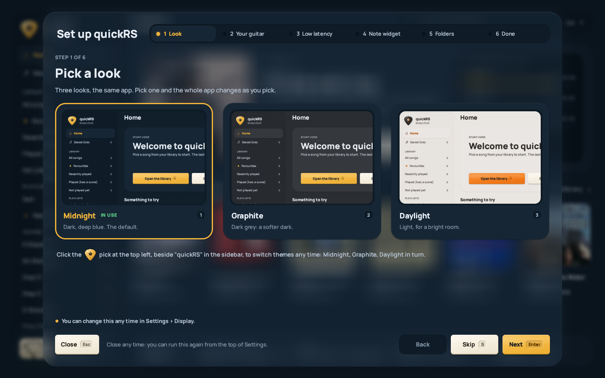

Installing quickRS
------------------
quickRS has no installer on Windows. On macOS it is an app you drag to
Applications. Neither version is signed with a paid certificate, so both
operating systems will warn you the first time. This page says what to click.

* [Windows](#windows)
* [macOS](#macos)
* [The first start](#the-first-start)
* [Where your data lives](#where-your-data-lives)
* [Uninstalling](#uninstalling)


### Windows

You need Windows 10 or 11, 64-bit.

1. Open the [latest release](https://github.com/arpan2711/quickRS-player/releases/latest).
2. Under *Assets*, click `quickRS-0.3.0-windows-x64.zip`. Not *Source code*.
3. In your Downloads folder, right-click the zip, choose *Extract All...*, then
   *Extract*.
4. Open the `quickRS-0.3.0` folder that appears. This is the quickRS folder.
   You can move it anywhere you can write to, such as your Documents folder.
   Avoid `C:\Program Files`: quickRS can't update itself there.
5. Double-click `quickrs.exe`.

The first time, Windows SmartScreen may say "Windows protected your PC". This
is because the program isn't signed (signing costs money every year). Click
*More info*, then *Run anyway*. Windows remembers the choice for that file.

For a Desktop shortcut, right-click `make_shortcut.ps1` in the quickRS folder
and choose *Run with PowerShell*.

What's in the folder:

| File | What it is |
| --- | --- |
| `quickrs.exe` | the player |
| `quickRS Converter.exe` | converts .psarc songs to feedpaks (optional) |
| `Convert songs.bat` | the same conversion in a console window |
| `quickrs-cli.exe` | command-line tools: song info, tabs, conversion, devices, take checks |
| `keys.example.json` | the shape of `keys.json`, with no keys in it |
| `make_shortcut.ps1` | puts a quickRS shortcut on the Desktop |
| `README.txt` | short instructions, offline |
| `licences` | licences |

Next: [the first start](#the-first-start).


### macOS

The Mac version is a beta. It runs on macOS 11 (Big Sur) or later, on Apple
silicon and Intel Macs (one universal app), built from the same source as the
Windows version. So far it's been tested on one Mac (a MacBook Air with Apple
silicon, macOS 15, a Focusrite Scarlett Solo), so please report what goes wrong.
On a Mac, the keys written Ctrl in these docs are Cmd (a take is `Cmd+R`).

1. Open the [latest release](https://github.com/arpan2711/quickRS-player/releases/latest)
   and download `quickRS-0.3.0-macos-universal.dmg`. (The
   `quickRS-0.3.0-macos-universal.zip` holds the same app.)
2. Open the .dmg and drag quickRS to Applications.
3. Open quickRS from Applications.

The app is signed ad hoc but not notarised with Apple (that needs a paid
developer account), so macOS refuses it the first time with "quickRS cannot be
opened because Apple cannot check it for malicious software" (or "...is
damaged", on some versions). To open it anyway:

* macOS 15 (Sequoia) and later: click *Done*, open *System Settings* >
  *Privacy & Security*, scroll down to the message about quickRS, click
  *Open Anyway*, and confirm with your password.
* macOS 14 and earlier: in Finder, Control-click (or right-click) quickRS in
  Applications, choose *Open*, then *Open* again in the dialog.

If macOS says the app is damaged, the download's quarantine flag is the
problem, not the file. In Terminal:

```
xattr -dr com.apple.quarantine /Applications/quickRS.app
```

The first time quickRS opens your guitar input, macOS asks whether quickRS may
use the microphone. Say yes. Every audio input counts as a microphone to macOS,
including a Real Tone Cable or an interface. If you said no, turn it on in
*System Settings* > *Privacy & Security* > *Microphone*. Because the app is
signed ad hoc, macOS may ask again after an update.

On a Mac there is no ASIO; quickRS uses Core Audio, which has low latency on
its own.

The command-line tools are inside the app:
`/Applications/quickRS.app/Contents/MacOS/quickrs-cli`, and the converter
window is `quickrs-convert` in the same folder.


### The first start

The first time you start quickRS, the first-time setup opens over the app.
It's a few short pages; *Next* goes on, *Back* goes back, *Skip* leaves a page
as it is, and you can close it any time. Each page says where in Settings to
change it later.

1. **Look.** Pick a theme: Midnight (dark blue, the default), Graphite (dark
   grey) or Daylight (light). The pick at the top left, beside "quickRS" in
   the sidebar, switches themes later.
2. **Your guitar.** The guided guitar setup: the input and its channel, where
   you hear it, a level check, what's plugged in, calibration and the open
   strings. About two minutes; have the guitar plugged in and tuned. See
   [AUDIO-SETUP](AUDIO-SETUP.md#the-guided-setup).
3. **Low latency** (Windows only). Turns on *Low-latency output*, so what you
   play comes back sooner. While it's on and quickRS is playing, other
   programs can't use that sound device. See
   [AUDIO-SETUP](AUDIO-SETUP.md#asio-and-wasapi).
4. **Note widget.** A small window that stays on top of everything: the note
   you're playing, the key you seem to be in, and its scale on the whole neck.
5. **Keys and folders.** Your song folders (quickRS has already looked for
   Rocksmith's `dlc` folder in your Steam libraries, so with Steam this is
   often done), Rocksmith's keys (only for `.psarc` files), and where
   recordings go. See [GETTING-SONGS](GETTING-SONGS.md).
6. **Done.** A summary of what's set.



To go through it again: *Run the first-time setup again* at the top of
Settings (`F2`), or *Set up quickRS* on Home. It opens with what you already
set.

Coming from 0.1.0, it may not open by itself: quickRS sees your song folders
or keys and leaves you be. Open it from Settings as above if you'd like the
guitar setup and calibration (worth it: scoring changed a lot since 0.1.0).

Next: [get your songs in](GETTING-SONGS.md).


### Where your data lives

Settings, scores, favourites, playlists, saved licks and saved sounds are
kept apart from the program, so replacing the program (by hand or with the
updater) keeps them.

| | Folder |
| --- | --- |
| Windows | `%APPDATA%\quickRS\data` (paste it into File Explorer's address bar) |
| macOS | `~/Library/Application Support/quickRS` |
| Portable | the program's own folder, or a `quickRS Data` folder next to it (on a Mac, next to quickRS.app), if it has a `config.json` or `userdata.json` |

In it: `config.json` (settings and song folders), `userdata.json` (scores,
favourites, playlists, saved licks, the amp room's saved sounds, each song's
pitch and stem mix), `keys.json` if you saved keys in Settings, `takes` (your
recorded takes) and `.quickrs-cache` (the library index, covers and
`quickrs.log`; safe to delete).

Recordings (`R`) go elsewhere: a `quickRS Recordings` folder in your Music
folder, named after the song. Settings > *Directories* > *RECORDINGS*
changes where recordings and takes go. See
[PLAYING](PLAYING.md#recording).


### Uninstalling

Delete the quickRS folder (Windows) or drag quickRS from Applications to the
Bin (macOS). To remove your settings and scores too, delete the data folder
above. quickRS never changes Rocksmith or your song files.
