Playing
-------
Pick a song in the library and press `Enter` (or `Shift+Enter` to pick the
part). `Space` plays and pauses. `Esc` goes back to the library. Every button
shows its key (on a Mac, Ctrl is Cmd); `F1` (or `?`) shows every key on one sheet, and the
[README](../README.md#keyboard-shortcuts) has the full list.

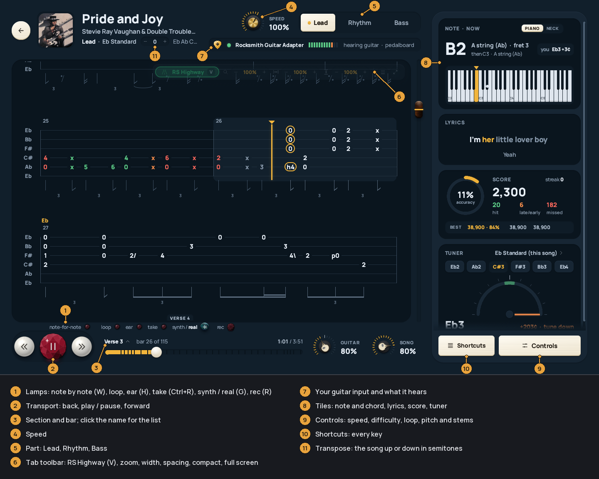

* [The tab](#the-tab)
* [The highway](#the-highway)
* [Loops and slowing down](#loops-and-slowing-down)
* [Selections and licks](#selections-and-licks)
* [Note by note](#note-by-note)
* [Ear mode](#ear-mode)
* [Scoring](#scoring)
* [Takes](#takes)
* [Recording](#recording)
* [Synth or real guitar](#synth-or-real-guitar)
* [Pitch and stems](#pitch-and-stems)
* [What's switched on](#whats-switched-on)
* [Tiles](#tiles)

### The tab

The whole part as pages of tab. The current bar is lit, the cursor moves
through it, and the next notes are ringed. The row you're on sits near the top
so you see what's coming. Scroll away and the page waits; it follows again
after a few seconds of playing. Click anywhere to jump there.

* `↑` `↓` zoom.
* `Alt+←` `Alt+→` make bars narrower or wider; `Alt+↑` `Alt+↓` move the
  strings further apart or closer. `Alt+0` puts both back.
* `C` compact rows: more rows on screen.
* `F` full-screen tab: no header, transport or console. `F` or `Esc` leaves.
  `F11` makes the window itself full screen.
* `N` rhythm notation under the tab.
* `A` / `Shift+A` next or previous part; `1`-`6` pick one.
* `Ctrl+↑` / `Ctrl+↓` harder or easier, like Rocksmith's difficulty.

The same controls are on the see-through toolbar at the tab's top right. Its
first key is *RS Highway* (`V`). It rolls up after a few seconds; hover it to
open it.

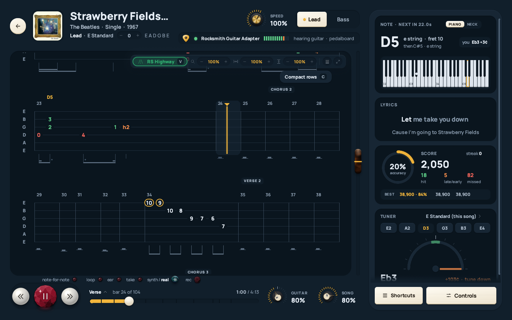

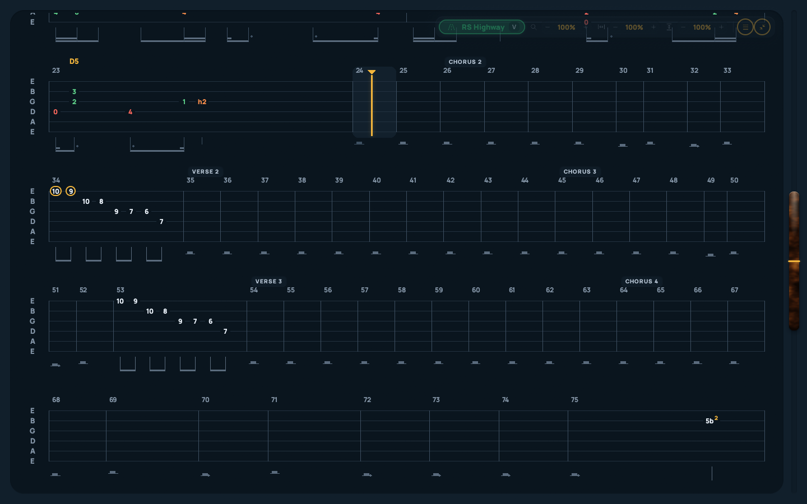

### The highway

`V` swaps the tab for a Rocksmith-style 3D note highway (or click *RS
Highway*, the first key on the tab's toolbar). `V` again, or the same key on
the highway's toolbar, goes back.

Notes come toward you and land on their strings. Hits light up, misses say
MISS. The camera follows the hand's position the way Rocksmith's does: it
moves seldom and early. On the highway's own toolbar:

* *Speed*: how fast notes come.
* *Camera*: *Rocksmith*, or *Steady*, which holds a view as long as it can.
* Invert (`I`): low E at the bottom instead of the top.

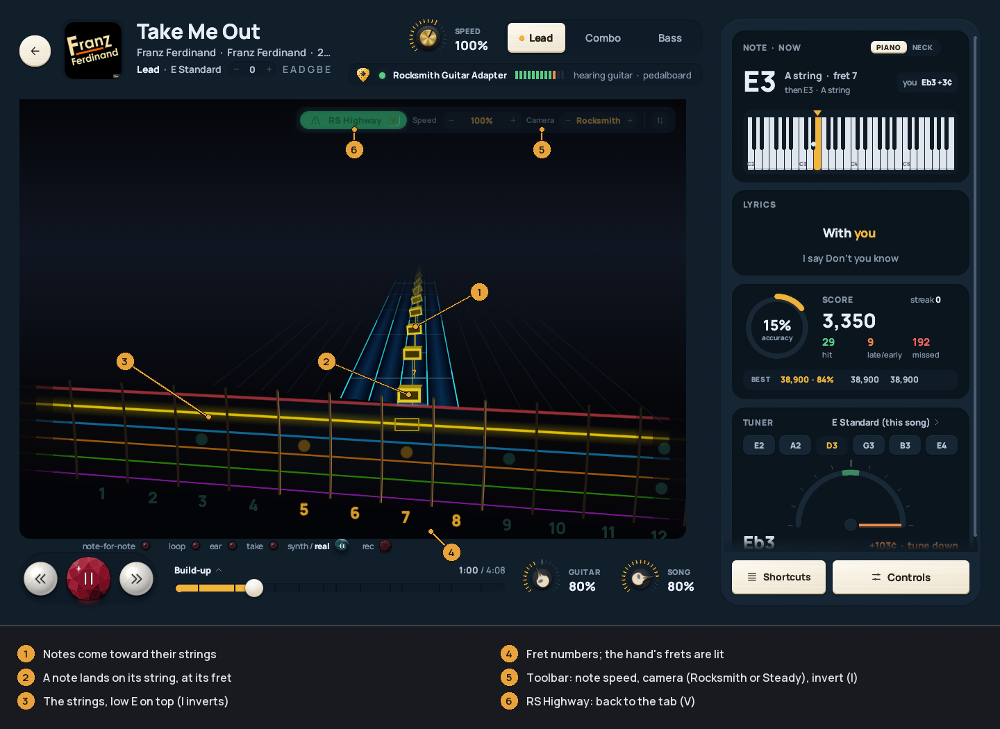

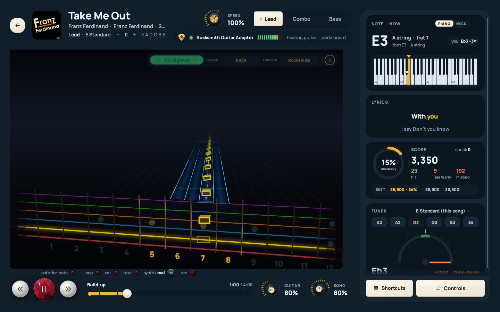

### Loops and slowing down

* `[` and `]` set the loop's start and end. They snap to the beat, and each
  pass has a short lead-in.
* `L` loops the section you're in. `\` clears the loop.
* `PgUp` / `PgDn` go to the previous or next section. Click the section name
  over the seek bar for a list.
* `=` and `Ctrl+=` speed up and slow down, 25% to 150%. The pitch stays the
  same.

The *Controls* key at the bottom right opens all of this: the speed and
difficulty dials, the loop keys, and *Level up after a clean loop*, which
raises the difficulty each time you play the loop cleanly.

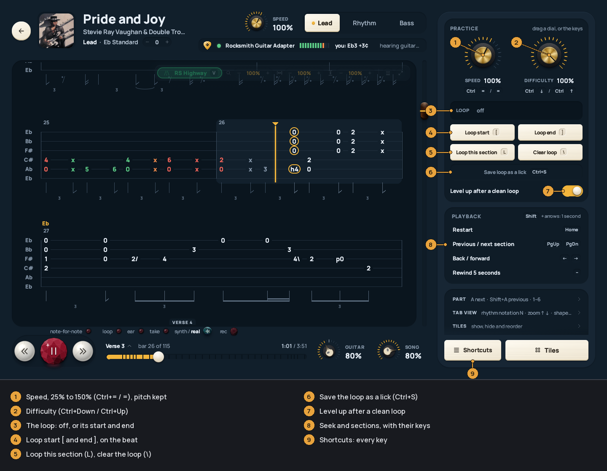

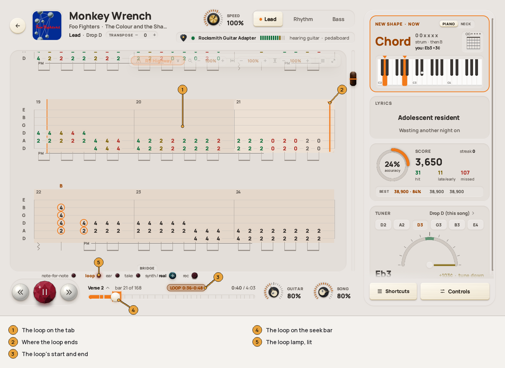

### Selections and licks

`Ctrl+drag` across bars (or `Ctrl+click` one bar) to select them. A small
toolbar appears:

* *Play* (`P`) plays the selection once, *Loop* repeats it.
* *Slow* (`S`) takes it to 70%, then 50%.
* The key on the left picks what you hear: a synth guitar playing exactly
  what's written, or the song's own recording.

`Ctrl+S` saves the selection (or else the loop) as a lick. The *Saved licks*
page, in the sidebar under Home, lists them with song, part, section and bars.
`Enter` opens one with the loop set; `Del` deletes it.

### Note by note

`W`, or the small lamp above the transport. The song stops at each note or
chord and waits until you play it, then goes on. Practise at your own speed,
with the band.

The lamp is a dark garnet when note by note is off. It lights up when it's on,
and breathes while it waits for you. On the tab, the note it waits for
breathes too, and a wrong note rings red.

* `Enter` skips the note it's waiting on.
* `Space` pauses for real.
* Seeking carries on from the new place.

Note by note isn't scored, and loops don't level up while it's on. It turns
itself off if the guitar input goes away.

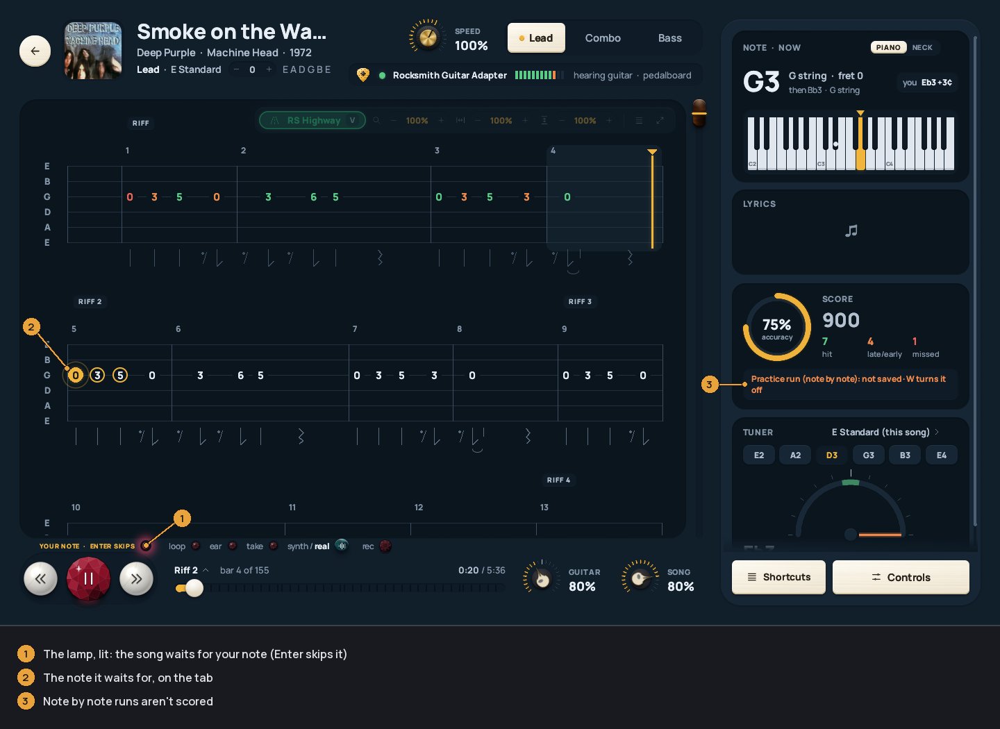

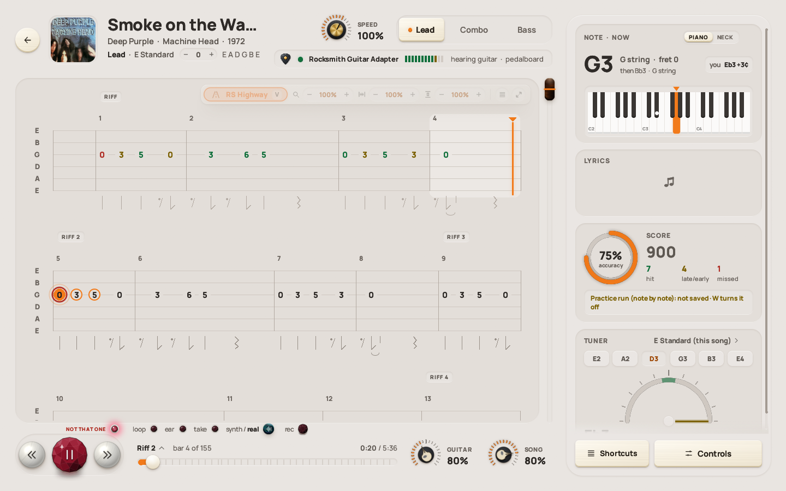

### Ear mode

`H` hides the tab's notes. Each one appears when you play it right. Use it to
work a part out by ear with the song as your guide.

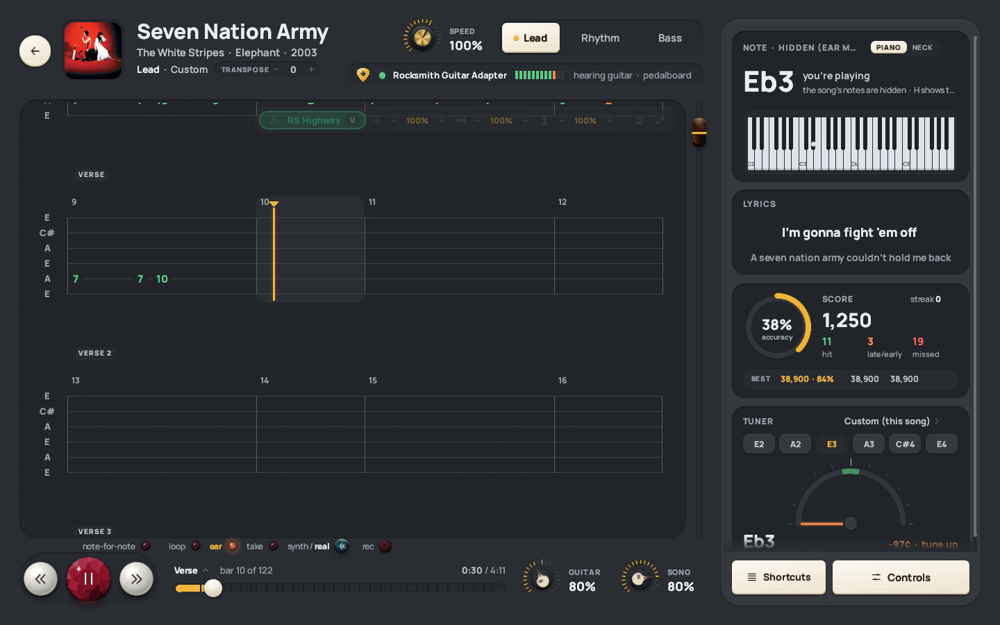

### Scoring

As you play, each note is judged: green for a hit, orange for early or late,
red for a miss. At the end a card gives accuracy, score, hits, early and late
notes, misses, and your best three runs for that part. Its close key (or
`Esc`) hides the card and leaves you on the song, to play it again;
`Backspace` goes to the library.

A chord is one hit or one miss, as in Rocksmith. It counts when at least half
its notes sound (both notes of a double stop), so up-strums and loose
down-strums count, while a wrong shape doesn't.

For good scoring, [calibrate your input](AUDIO-SETUP.md#calibrating-your-input)
and check [timing](AUDIO-SETUP.md#timing).

### Takes

`Ctrl+R` records a take of the loop (or the selection): a count-in, the loop
once at the speed you're at, then an analysis. `Ctrl+R` again stops it. (`R`
on its own [records what you hear](#recording).)

The result card shows accuracy and timing, the bars coloured by how they went
(click one to go there), and the problems in words, by bar number. On the tab,
your notes are drawn over the chart: right, early, late, wrong (with the fret
you played) and missed. `B` plays the take back over the song.

The analysis is done on your computer, without AI or a server. When it can't
hear a note clearly (a quick hammer-on, a muted strum) it gives you the benefit
of the doubt.

Takes are saved as WAV files in the takes folder, the last 10 per passage.
It's the data folder's `takes` folder unless you pick another in Settings >
*Directories* > *RECORDINGS*.

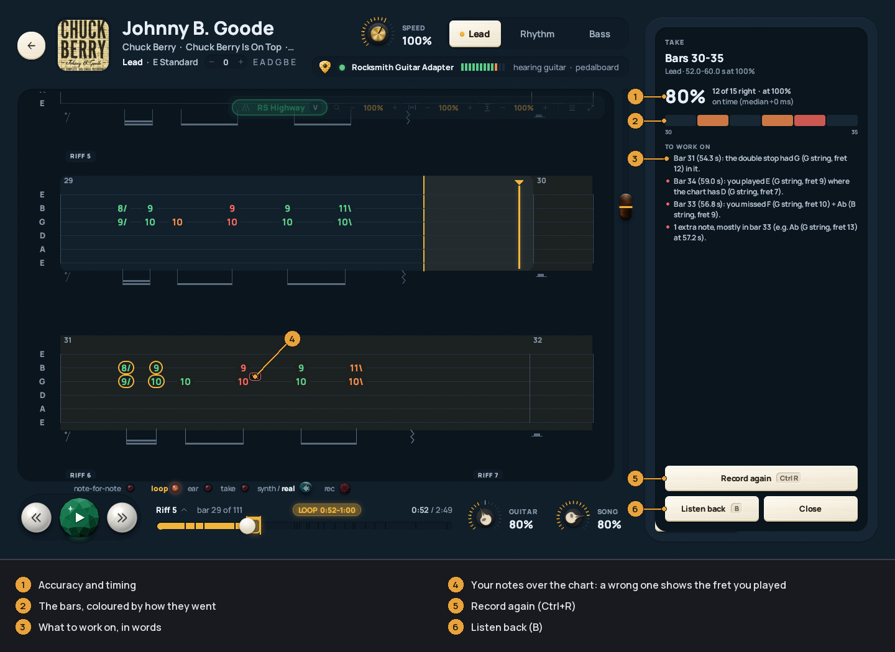

### Recording

`R` records what you hear: the song (or the synth) and your
guitar through the rig, the whole mix, to a WAV file. It works in a song and
in the [amp room](AUDIO-SETUP.md#the-amp-room).

* `R` starts. While it runs, a red lamp, the time and the keys show.
* `R` again pauses, and `R` once more carries on in the same file.
* `Shift+R` stops and saves it. A notice gives the file's name and *Open
  folder*, which opens the folder with the file selected.

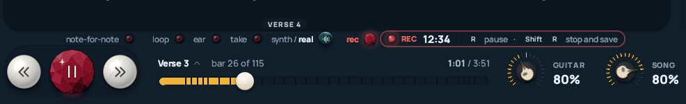

The garnet *rec* key above the transport does what `R` does. Leaving the song
or the room stops and saves the recording too. Your guitar is in it even when
you've turned off hearing it (`M`). Any length works.

While it runs, the recording is written to quickRS's own cache folder. It
appears in your recordings folder when you stop it, as a complete file that
any player or editor can open, so the folder only ever holds finished
recordings. A recording under a second long isn't kept. If quickRS closes
unexpectedly mid-recording, the next start repairs what was recorded and puts
it in the folder with *(recovered)* in its name.

A recording from a song is named after the song, then the date and time:
`Reptilia - quickRS 2026-10-29 14-03-22.wav`, so a folder sorted by name keeps
a song's recordings together. From the amp room it's
`quickRS <date> <time> <rig>.wav`. They go to a `quickRS Recordings` folder in
your Music folder (or Documents, if there is no Music folder). Settings >
*Directories* > *RECORDINGS* has *Change...*, *Open* and *Default* for it.

A recording isn't scored or checked; for that, use a [take](#takes).

### Synth or real guitar

`G` (or the *synth / real* key above the transport) swaps the
recording's guitar for quickRS's synth playing exactly what the tab says for
the part you're on. `G` again brings the real recording back. The choice is
remembered.

For a feedpak with stems, the part's own stem is left out and the synth takes
its place. For a song without stems (every psarc), the song is turned down and
the synth plays over it, since the recording's guitar can't be taken out.

Speed, loops, seeking and pitch shift work as usual. After a change of part,
difficulty or sync the synth is made again, which takes a moment; the old one
plays until then.

### Pitch and stems

Both are in *Controls* > *PITCH & STEMS* (just *PITCH* for a song without
stems).

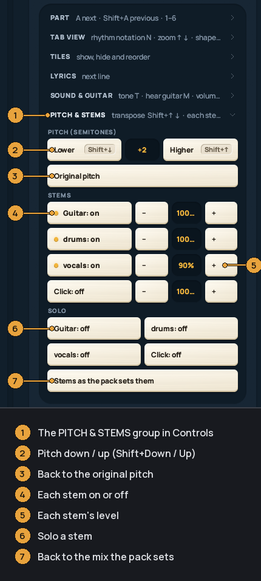

(The picture is from a small example pack with guitar, drums, vocals and click
stems.)

**Pitch.** `Shift+↑` and `Shift+↓` (or *Higher* and *Lower*, or the `−` and
`+` of *TRANSPOSE* in the header, beside the tuning) move the song up
or down a semitone at a time, from 12 down to 12 up. *Original pitch* puts it
back. The tab stays as written: the frets don't change, only what you hear.
Scoring, the tuner's *this song* tuning, the synth guitar and takes all expect
the shifted pitch, so you can play a song in E standard along with a record
tuned down a half step, or use a capo and play the tab's shapes. Pitch shift
works together with slow-down. A change takes a moment: the old version plays
until the new one is ready.

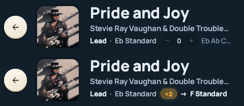

**Stems.** A feedpak can carry the song as separate stems: guitar, bass,
drums, vocals and so on. quickRS plays all of them together. For each stem
you get on/off, a level (`−` and `+`) and *SOLO*; a muted stem stays silent
even when soloed. Turn the guitar down to play the part yourself, or solo the
bass to hear what it's doing. *Stems as the pack sets them* goes back to the
pack's own mix (when the pack has a full mixdown, that plays then).

Psarcs have one mixed track, so they have pitch but no stems.

The pitch and the mix are remembered per song.

### What's switched on

The player shows what you've changed. Red means something is taken away: with
your guitar muted (`M`) the GUITAR knob reads MUTED. Amber means something is
changed from normal: the speed knob off 100%, a pitch shift (the header's
*TRANSPOSE* shows the amount and what to tune to), a loop, a tone picked
with `T`, an easier difficulty, a sync or guitar timing change.

The lamps above the transport (note by note, loop, ear mode, take) can be
clicked, and so can the *synth / real* and *rec* keys after them. A key that
does something shows its keycap and what it did at the tab's foot.

### Tiles

The console at the right has tiles: note and chord (on a piano or the guitar
neck), lyrics (`Y`), score, a tuner set to the song's tuning, and the
pedalboard (`Shift+T` lists your saved sounds there). Drag a tile to move
it; its close key hides it; *Tiles* brings it back. Hover a tile and the grey
key beside its grab bar folds it to a slim strip; click the strip to open it
again.

The note widget is a small window that stays on top of everything: the note
you're playing, the key quickRS thinks you're in, and that key's scale on the
whole neck. Click the scale to make it big. Right-click hides it. Turn it on in
the first-time setup or in Settings > *Audio input / output* > *Note
widget*.
