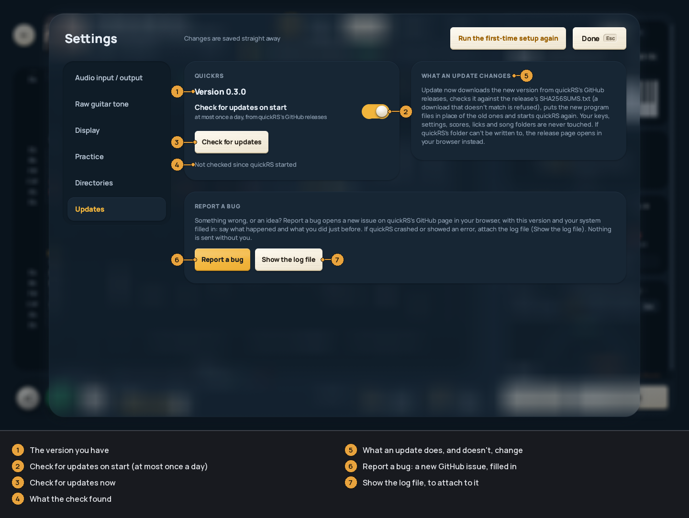

Updating
--------
Your keys (if you saved them in Settings), settings, scores, playlists, saved
licks and saved sounds live in the
[data folder](INSTALL.md#where-your-data-lives), not in the program's folder.
Updating replaces the program and leaves them alone.

* [From 0.1.0](#from-010)
* [What changed since 0.1.0](#what-changed-since-010)
* [From 0.3.0 on: the updater](#from-030-on-the-updater)
* [By hand](#by-hand)

### From 0.1.0

0.1.0 can't update itself, so download the 0.3.0 zip by hand, this once.
After that, quickRS updates itself: Settings > *Updates*.

1. Close quickRS.
2. Download `quickRS-0.3.0-windows-x64.zip` from the
   [latest release](https://github.com/arpan2711/quickRS-player/releases/latest)
   and extract it (right-click, *Extract All...*).
3. Either:
   * copy everything in the new `quickRS-0.3.0` folder over your old quickRS
     folder (say yes to replacing the files), or
   * keep the new folder beside the old one and copy your `keys.json` from the
     old folder into the new one, next to `quickrs.exe`. (Or skip this and
     paste the keys in Settings > *Directories* later.) If you made a Desktop
     shortcut, run `make_shortcut.ps1` in the new folder.
4. Start the new `quickrs.exe`. If you kept both folders, delete the old one
   once you're happy.

Your settings, song folders and scores are in `%APPDATA%\quickRS\data` and
carry over by themselves.

If you ran 0.1.0 as a portable install (a `config.json` next to
`quickrs.exe`), copying over the old folder keeps it as it is; with a new
folder, copy `config.json`, `userdata.json` and `keys.json` into it as well.

The [first-time setup](INSTALL.md#the-first-start) may not open by itself
for you, since quickRS sees you've used it before. *Run the first-time setup
again* at the top of Settings (`F2`) opens it. At least run *Your guitar*
once: calibration and scoring are new since 0.1.0.

### What changed since 0.1.0

Your settings, scores, favourites and playlists carry over. Some names and
places changed:

* Settings sections: *Audio* is *Audio input / output*, *Library* is
  *Directories*, *Guitar tone* is *Raw guitar tone*.
* Keys go in Settings > *Directories* > *ROCKSMITH KEYS* (paste them and
  press *Save keys*). `keys.json` in the quickRS folder still works, and so
  does `keys.json.txt`. There's no need to restart or press `F5` after adding
  keys any more.
* Song folders are listed in Settings > *Directories* > *SONG FOLDERS*, with
  *Add folder...* and *Remove*. Dragging a folder onto the window still works.
* New keys in the player: `W` note by note, `H` ear mode, `V` the highway,
  `I` invert the highway's strings, `C` compact rows, `F` full-screen tab,
  `Alt+arrows` the tab's shape, `Ctrl+R` a take, `B` listen back, `R` record
  what you hear (`Shift+R` stops and saves), `G` synth or real guitar,
  `Shift+↑` / `Shift+↓` pitch, `Shift+T` your saved sounds, `Ctrl+S` save a
  lick, `F1` or `?` every key. The full list is in the
  [README](../README.md#keyboard-shortcuts).
* On Home, `A` opens the amp room.

See [the release notes](https://github.com/arpan2711/quickRS-player/releases/tag/v0.3.0)
for everything that's new.

### From 0.3.0 on: the updater

When quickRS starts, it asks GitHub for the latest quickRS release, at most
once a day. If there is a newer version, a notice appears at the bottom left of
Home, the library and Settings (never over a song you're playing), with:

* *Update now*: downloads the new version and installs it.
* *Later*: the notice goes away until the next start.
* *Skip this version*: it isn't offered again on start.
* *Release notes*: the release page, in your browser.

Nothing is downloaded until you press *Update now*. Then quickRS downloads the
zip for your system and the release's `SHA256SUMS.txt`, and refuses a download
that doesn't match its checksum before anything is changed. It puts the new
program files in place of the old ones and starts again. If something fails
halfway, the old files are put back.

An update never touches your keys (`keys.json`, `keys.json.txt`),
`config.json`, `userdata.json`, your takes or your recordings, even when they
are in the program's folder.

If quickRS's folder can't be written to (for example under
`C:\Program Files`), it opens the release page in your browser instead, and
you update [by hand](#by-hand).

Settings (`F2`) > *Updates* has the rest:

* *Check for updates on start*: turn it off and quickRS never asks GitHub by
  itself.
* *Check for updates*: ask now. When there is a new version, *Update now* and
  *Release notes* appear next to it.
* A skipped version shows here with *Offer it again*.
* *Report a bug* and *Show the log file*: see
  [TROUBLESHOOTING](TROUBLESHOOTING.md#reporting-a-bug).

The check asks GitHub's public API for the latest release, and the request
says which version of quickRS is asking. Nothing about you or your songs is
sent.

On a Mac the updater replaces `quickRS.app` as a whole. Keep quickRS in
Applications (or another folder you can write to): an app started from the
.dmg or straight from Downloads can't replace itself, so you get the release
page instead. Because the Mac app is signed ad hoc, macOS may ask for the
microphone again after an update.

### By hand

Windows: close quickRS, extract the new zip, and copy the new files over the
old ones in the quickRS folder (or use the new folder and copy `keys.json`
across, as above).

macOS: download the new `.dmg` and drag quickRS to Applications again,
replacing the old one. macOS may ask you to allow it again (see
[INSTALL](INSTALL.md#macos)).
